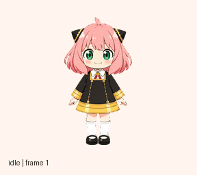
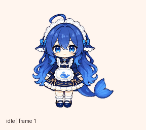

# ChatGPT 自定义宠物

这里收录两只可直接导入 ChatGPT「Mini 与虚拟宠物」的动画宠物：**阿尼娅·福杰**与**汐墨**。每只都包含官方 v2 精灵图、逐状态动画预览、桌面包和校验记录。

## 动画预览

**阿尼娅·福杰**

**汐墨**

## 下载与启用

1. 在仓库页面选择 **Code → Download ZIP** 并解压。
2. 打开 ChatGPT **设置 → Mini 与虚拟宠物 → 创建虚拟宠物**。
3. 选择对应目录中的 `work/spritesheet.png`，填写名称与描述并创建。

- 阿尼娅：[`pets/anya-forger/work/spritesheet.png`](pets/anya-forger/work/spritesheet.png)
- 汐墨：[`pets/ximo/work/spritesheet.png`](pets/ximo/work/spritesheet.png)

## 素材与校验

- 两张上传用 PNG 都是透明背景的 **1536 × 2288** v2 精灵图，单格 **192 × 208**，包含 73 个有效动画帧和 15 个透明空格。
- 九种工作状态与十六个注视方向按 ChatGPT v2 布局排列；两张 PNG 均通过官方素材预检。对应 `verification.json` 记录帧数、尺寸和 SHA-256。
- `desktop/` 中的 `pet.json` 与无损 WebP 是桌面包；其可见像素和透明度已逐像素与 PNG 核对。
- `preview/all-states.gif` 用来快速查看动画，不替代上传用 PNG。

## 放大显示说明

上传素材本身没有经过有损压缩。宠物格式把每帧限制在 192 × 208 像素；当前桌面客户端以像素化方式放大帧，因此调大宠物尺寸时仍可能看到像素边缘。这是帧尺寸与客户端放大方式共同造成的显示效果，单纯把整张精灵图放大后再上传不会增加角色细节，也会破坏规定尺寸。

## 声明

阿尼娅·福杰是《间谍过家家》角色，相关角色和作品权利归权利人所有。本仓库中的对应图片为个人自定义、非官方素材。汐墨为原创角色形象。本仓库不包含账号标识、登录凭据、上传链接或用户提供的参考图片。
